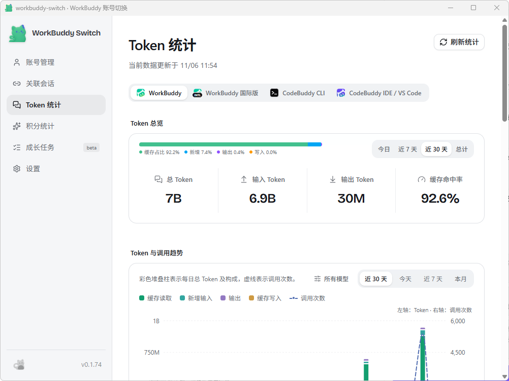

# WorkBuddy 专家团 · 精益求精服务（Excelsior）

**WorkBuddy 专家团 / WorkBuddy Expert Team** — 1 位主理官 + 5 位专职专家 + 45 项内置技能，融合 14 个 GitHub 开源工程框架，100% 跨语言通用的 WorkBuddy 专家包。

**Excelsior (v5.0 Universal Edition — 1 Lead + 5 Specialists, 45 Built-in Skills)**

[](LICENSE)


> **一键使用**：用 WorkBuddy 创建了一个专家团「精益求精服务」——融合 10 大 GitHub 开源工程框架（内置 45 项技能，100% 跨语言通用）：听懂大白话自动规划、开工前先报《方案卡》确认、强制检索优秀开源项目参考、六段式元提示词委派、写出优雅代码、交付杂志级接线文档。
>
> 👉 [点击一键复制使用](https://www.workbuddy.cn/work/launch/?sharecode=mG8J8WmThE1btKIXR1sUvN4tlP_5oTQH4XWrBow0G6nBwF5340SjlBX05MF0zyuT&expertname=%E7%B2%BE%E7%9B%8A%E6%B1%82%E7%B2%BE%E6%9C%8D%E5%8A%A1&buddy_type=workbuddy)

`WorkBuddy 专家团` · `WorkBuddy 专家包` · `WorkBuddy 插件` · `AI 编程专家团` · `多 Agent 协作` · `提示词工程` · `Claude Skills` · `SKILL.md` · `一键导入专家`

## 一、 融合的十大 GitHub 开源工程体系（100% 跨语言、跨项目通用）

本专家团将当前开源社区最成熟的 **10 大多 Agent 协同与软件工程体系** 深度浓缩为 **45 个内置 `SKILL.md` 技能** 与 **「1 主理官 + 5 专职专家」** 的协作提示词，零外部依赖、对任何开发者与任何技术栈开箱即用：

| 开源工程体系 | 核心融入机制 |
| :--- | :--- |
| **1. `ruvnet/ruflo` (Claude Flow)** | **提案先行门禁（Proposals, Not Orders）**、并行文件独占写锁（Resource Claims Board）、SPARC 五步研发闭环、四步项目记忆蒸馏（`RETRIEVE→JUDGE→DISTILL→CONSOLIDATE`） |
| **2. `gsd-build/get-shit-done` (GSD)** | **极薄主理官（Thin Orchestrator）防上下文腐烂**、四维前置调研（Stack / Features / Architecture / Pitfalls）、六段式结构化元提示词委派（Meta-Prompting）、微任务内联免折腾规则 |
| **3. `affaan-m/ECC` (Everything Claude Code)** | **规划/审查严格只读分离**、**`>80% 置信度` 审查过滤门槛**（合并同类项、剔除主观噪音，只报真 Bug、安全漏洞与结构性缺陷） |
| **4. `FoundationAgents/MetaGPT`** | **`Code = SOP(Team)` 自然语言编程流水线**：一句日常大白话自动展开为「开源/竞品对标 → 数据结构与接口设计 → 切片工单 → 优雅代码与文档」 |
| **5. `bmad-code-org/BMAD-METHOD`** | **自适应流程体量（Right-Sized Process）** 与 **渐进式上下文交接（Progressive Context Handoff）**，确保实现者拿到完整的调研与全调用链核对表 |
| **6. `github/spec-kit`** | **《优雅代码与交互工程宪法》门禁**：顶部扁平卫语句、表驱动代替分支堆砌、入口边界一次性类型归一化、成对接口对称性 |
| **7. `mattpocock/skills`** | 证据先行压力访谈（Grilling）、统一语言（`GLOSSARY.md`）、架构决策记录（`ADR`）、曳光弹垂直切片拆解（`/to-tickets`）、深模块 TDD 与科学缺陷诊断（`/diagnosing-bugs`） |
| **8. `DietrichGebert/ponytail`** | 六级极简决策阶梯（有原生/现成组件绝不造轮子，不引多余依赖）、全仓减肥审计（`audit`）与刻意捷径技术债台账（`debt`） |
| **9. `pbakaus/impeccable` + `vercel-labs/agent-skills`** | 24 项 UI/UX 命令、4 大表面模式、62 条反 AI 廉价感（Anti-Slop）铁律、40+ 条 React/前端性能规则与 Playwright 双视口实测验证 |
| **10. `D4Vinci/Scrapling` + `trailofbits/skills` + `obra/superpowers` + `supabase/agent-skills` + `karpathy-guidelines`** | 真实网页自适应探测、Trail of Bits 差分安全与爆炸半径审计、Karpathy 四大编码铁律、完工实证门禁、Git Worktree 隔离与 Postgres 数据库最佳实践 |

---

## 二、 核心使用体验（四大黄金特性）

1. **只管说大白话，自动补齐隐性工作**：
   - 你无需输入专业术语或手动指定调用哪个专家。主理官**程致远**会自动把大白话转化为工程闭环，并默认补齐耗时操作进度反馈、防并发重入互斥锁、向后兼容与备份回滚方案。
2. **先问清再开工（《任务理解与开工方案卡》门禁 — 1A 标准）**：
   - 单文件 ≤20 行的明确微调直接秒级办妥；
   - 凡涉及**新功能、修改 ≥2 个文件、架构/数据变更或存在方案分歧**，主理官会先静默查清本地代码并派 **叶探真** 搜完 GitHub 现成优秀开源方案，向你汇报一张一页纸 **《任务理解与开工方案卡》**，**必须等你点头确认后才动刀写代码**，彻底杜绝盲目乱改。
3. **优雅代码优先于病态压行数（`/code-elegance` — 3A 标准）**：
   - 强制采用顶部扁平卫语句（Early Return）、声明式映射表（Lookup Table）代替冗长分支、在模块边界一次性完成类型归一化（Parse, Don't Validate）、成对 API 签名对称；严禁为了省几行代码写出晦涩难懂的链式三元表达式。
4. **杂志级交付卡与架构接线文档（`/elegant-delivery-docs` — 3A 标准）**：
   - 每次完工在聊天窗输出包含 **一句话成果 + 优雅设计取舍表 + ASCII 模块接线微图 + 实测证据 + 操作与回滚口令** 的交付报告；对于新模块开发或跨文件架构改造，自动在项目中额外生成带完整接线图与最小可复制模板的 `.md` 指南。

---

## 三、 专家团成员一览（1 主理官 + 5 专职专家）

| Agent ID | 姓名 | 角色定位与核心职责 |
|----------|------|--------------------|
| `lean-adaptive-engineering-team-lead` | **程致远** | **首席主理官**：大白话意图解码、报《开工方案卡》确认、六段式元提示词委派、文件独占锁调度与最终交付 |
| `scrapling-web-intelligence` | **叶探真** | **开源方案对标与网页情报专家**：开发前检索 GitHub 高星开源项目、官方文档与框架原生组件；Scrapling 网页探测与 Playwright 取证 |
| `domain-grilling-architect` | **顾明析** | **全调用链建模与架构接线专家**：跨文件工程的全仓读写路径防漏扫描、状态机与崩溃一致性建模、曳光弹工单拆解与 `.md` 接线文档撰写 |
| `ponytail-simplicity-gatekeeper` | **简力行** | **极简、代码优雅度与安全差分审查官**：六级决策阶梯、Karpathy 外科手术边界、Trail of Bits 爆炸半径审计与 `>80% 置信度` 高信噪比审查 |
| `impeccable-design-director` | **颜至善** | **Impeccable UI/UX 与前端性能总监**：24 项设计命令、62 条反 AI Slop 规则、SVG/可视化图层架构、前端性能优化与真实浏览器双端验证 |
| `deep-module-tdd-engineer` | **秦笃行** | **TDD 深模块与优雅代码研发专家**：深模块封装、`/code-elegance` 优雅实现、Red-Green-Refactor TDD、科学缺陷诊断与独立门禁复核 |

---

## 四、 安装与使用

### 方式一：一键导入（推荐）

点击上方 [一键复制使用](https://www.workbuddy.cn/work/launch/?sharecode=mG8J8WmThE1btKIXR1sUvN4tlP_5oTQH4XWrBow0G6nBwF5340SjlBX05MF0zyuT&expertname=%E7%B2%BE%E7%9B%8A%E6%B1%82%E7%B2%BE%E6%9C%8D%E5%8A%A1&buddy_type=workbuddy) 链接，用 WorkBuddy 打开即可复制使用。

### 方式二：手动放入插件目录

```bash
git clone https://github.com/Binbin-miao/excelsior.git lean-adaptive-engineering
```

把克隆出来的 `lean-adaptive-engineering` 文件夹放入 WorkBuddy 插件目录：

- Windows: `%USERPROFILE%\.workbuddy\plugins\marketplaces\my-experts\plugins\lean-adaptive-engineering`
- macOS / Linux: `~/.workbuddy/plugins/marketplaces/my-experts/plugins/lean-adaptive-engineering`

### 方式三：同步技能到全局（可选）

在目录内运行 `python install_skills.py`，可将包内全部 **45 个内置技能** 一键同步至全局 `~/.workbuddy/skills`。

---

## 五、 实盘 Token 使用情况

不是 PPT 项目。以下是作者本机近 30 天的真实 Token 消耗（由 [WorkBuddy Switch](https://github.com/Binbin-miao/workbuddy-switch-binbinbin) v0.1.74 统计）：



| 指标 | 数值 |
|:---|:---|
| 近 30 天总 Token | **7B** |
| 输入 Token | 6.9B |
| 输出 Token | 30M |
| 缓存命中率 | **92.6%** |

> 缓存命中率 92.6% 是这个专家团的核心工程指标：稳定的系统提示词前缀 + 技能按需加载，避免每次对话重新灌一遍上下文，长期重度使用才跑得出这个数。

---

## 六、 致谢

本项目建立在一批高质量开源工程体系的肩膀上，14 个上游项目的完整清单、许可证与对应技能映射见 **[NOTICE.md](NOTICE.md)**。

特别感谢：`mattpocock/skills`、`DietrichGebert/ponytail`、`pbakaus/impeccable`、`D4Vinci/Scrapling`、`trailofbits/skills`、`obra/superpowers`、`ruvnet/ruflo`、`gsd-build/get-shit-done`、`affaan-m/ECC`、`FoundationAgents/MetaGPT`、`bmad-code-org/BMAD-METHOD`、`github/spec-kit`、`vercel-labs/agent-skills`、`supabase/agent-skills`。

---

## 七、 许可证

本项目原创的编排逻辑、提示词与文档以 [MIT](LICENSE) 授权；第三方素材版权归各自作者，按其原始许可证使用，详见 [NOTICE.md](NOTICE.md)。
