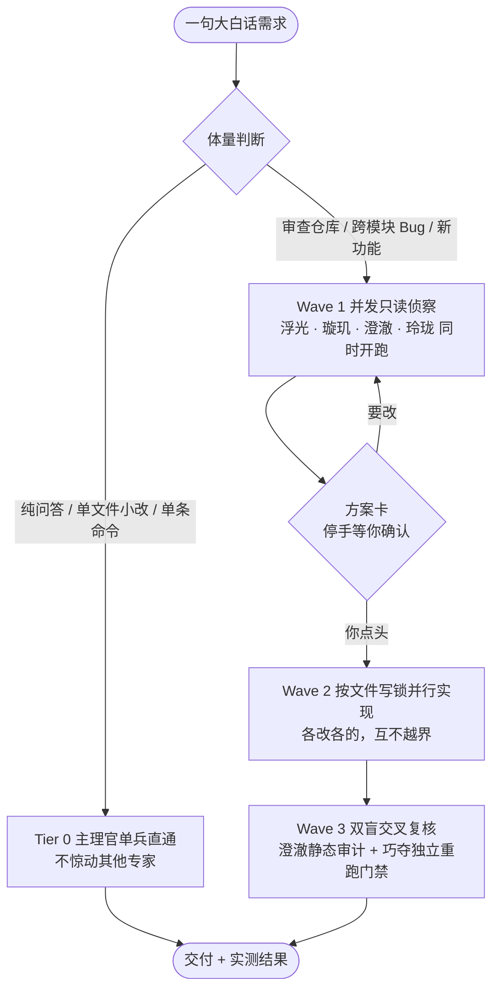

# 🚀 精益求精服务 (Excelsior) v6.0 — 自主并发全能软件工程专家团队

> **“Zero Bloat, Maximum Craftsmanship.”** — 零膨胀、高匠心，听懂大白话、模型自主判断多 Agent 并发波次委派与双盲交叉验证的全能软件工程专家团。

本仓库为 **WorkBuddy** / **CodeBuddy** 的专家团队插件，内置 **1 位首席主理官 (`天枢`) + 5 位专职顶尖专家 (`璇玑` / `澄澈` / `浮光` / `玲珑` / `巧夺`)**，并全量注入 **46 项开源软件工程技能 (`skills/*/SKILL.md`)**，对所有编程语言与技术栈 **100% 开箱即用**。

## 🔗 一键安装与配置 (WorkBuddy)

如果你正在使用 WorkBuddy，可以通过下方按钮或复制分享链接快速将本插件添加到你的环境中：

- **一键使用 / 添加插件**：  
  [](https://www.workbuddy.cn/work/launch/?sharecode=Y6QAJ8WUvUa4koEmjmaLdOJcFJhLoAuN66YQ8t_hGwBo7umTh-Jyl7zT9eex2VbI&expertname=%E7%B2%BE%E7%9B%8A%E6%B1%82%E7%B2%BE%E6%9C%8D%E5%8A%A1&buddy_type=workbuddy)
- **分享链接**：  
  `https://www.workbuddy.cn/work/launch/?sharecode=Y6QAJ8WUvUa4koEmjmaLdOJcFJhLoAuN66YQ8t_hGwBo7umTh-Jyl7zT9eex2VbI&expertname=%E7%B2%BE%E7%9B%8A%E6%B1%82%E7%B2%BE%E6%9C%8D%E5%8A%A1&buddy_type=workbuddy`

> **【首次使用请让 AI 自行安装所需技能】** 导入后首次对话，直接说一句「请先检查并自行安装你需要的技能」，专家团会补齐 46 项内置技能后再开工。

---

## ✨ v6.0 核心架构亮点

1. **模型自主判断多 Agent 并发波次调度（`/dispatching-parallel-agents` — 无需手动催促）**
   - **Tier 0 微任务免打扰直通**：纯问答、单条命令或单文件 ≤20 行明确微调，由主理官 **天枢** 直接单兵秒级办妥，零子代理通信开销。
   - **Tier 1~3 中大型任务全自动三波次并发（Wave Fan-Out / Fan-In）**：
     - **🌊 Wave 1 并行只读侦察波**：遇到代码审查、复杂 Bug 排查、性能优化或新功能设计，**天枢**自动在同一回合并发派出 **浮光**（外部开源对标与上游溯源）+ **璇玑**（全仓调用链与并发锁扫描）+ **澄澈**（安全爆炸半径与性能热点审计）+ **玲珑**（UI 生命周期审查）+ **巧夺**（**唯一编译/门禁实跑员**，其余只读专家禁跑重型编译以防锁争用卡死）。
     - **📋 Wave Barrier 1 方案卡确认门禁**：收齐侦察结果并剔除被证伪假设后，先呈交简明 **《任务理解与开工方案卡》**，经你点头确认后再动刀写代码。
     - **🌊 Wave 2 分片写锁并行实现波**：跨模块任务自动按目录分配互不重叠的文件写锁（Resource Claims），并发派出多个实现实例（如 `巧夺-Core` + `玲珑-UI` + `巧夺-Host`），主理官全程禁手不抢改工作树。
     - **🌊 Wave 3 同角色多实例双盲交叉验证波**：完工后自动并行派出 **澄澈**（静态差分审查）+ **巧夺-Verifier**（独立门禁复跑与沙箱化对抗测试，严禁污染主工作树）。
2. **大白话意图解码与隐性工程防呆（`/subagent-prompt-architecture`）**
   - 只需输入一句日常大白话，自动补齐耗时操作进度反馈、防并发重入互斥锁（RAII 自动释放）、读路径零写盘副作用、写前备份+写后校验+失败自动回滚事务、异步监听器卸载守卫（`disposed` guard）与 Single-Flight 缓存复用。
3. **优雅代码美学（`/code-elegance`）与杂志级交付文档（`/elegant-delivery-docs`）**
   - 强制采用顶部扁平卫语句（Early Return）、声明式映射表（Lookup Table）代替冗长分支、入口边界一次性类型归一化（Parse, Don't Validate）、成对接口签名对称，拒绝为压行数牺牲可读性。
   - 完工输出带 **ASCII 接线微图、设计取舍对比表、实测证据与回滚后路** 的交付卡，中大型改造自动沉淀独立 `.md` 架构接线指南。

---

## 🎯 我能帮你干什么 (What I Actually Do)

> 你只需要丢一句大白话，拆解、派活、验收由我组织。下面不是宣传语，是每次交付都要兑现的行为约束。

### 四条硬规矩 (Non-Negotiable Rules)

| # | 规矩 | 具体表现 |
| :--- | :--- | :--- |
| **1** | **不确定就问，不替你假设** | 方案出现分支（技术路线 / 环境边界 / 功能粒度 / 成本取舍）时，列出 2~3 个大白话选项、各自代价与我的推荐，由你拍板；绝不自行假定默认方案就闷头开写 |
| **2** | **能自己查的绝不问你** | 目录结构、源码引用、日志报错这类能用 `grep` 查出来的事实，我静默查完闭环，不把查证成本转嫁给你 |
| **3** | **不拿嘴说「应该能跑」** | 交付前必须有真实 Exit Code 0 与真实测试输出；跑不出来就直说卡在哪、卡了多久，绝不编造验证结果 |
| **4** | **删东西先列清单** | 删除、覆盖、批量重命名、推送到远程这类不可逆操作，一律先列完整影响清单，逐项确认后执行 |

### 调度流程 (Dispatch Flow)



关键点在**菱形那个「方案卡」**：侦察完不会闷头往下写，会先停下来告诉你「我准备怎么改、动哪几个文件、有什么风险」，等你点头才动刀。

### 典型场景与主力配置

| 你的诉求 | 谁上场 |
| :--- | :--- |
| 「这服务怎么起不来了 / 一直报错」 | **天枢** 定位 → **巧夺** 复现与修复 → **澄澈** 差分复查 |
| 「这段代码有没有坑」 | **澄澈** 静态审计 + **巧夺** 独立门禁复跑（双盲，互不通气） |
| 「把这个站的数据扒下来」 | **浮光**（Scrapling 自适应抓取，可应对 Cloudflare 反爬） |
| 「我想做个 xxx 工具 / 网页」 | **天枢** 拆方案 → **巧夺** 实现 → **玲珑** 管界面 → 双盲验收 |
| 「A 方案和 B 方案选哪个」 | **浮光** 查外部同类实现 + **璇玑** 评估你这边现实约束 |
| 「这功能为什么这么慢」 | **澄澈**（性能热点按性价比排序）+ **璇玑**（调用链定位） |
| 「帮我把这套代码重构干净」 | **璇玑** 全调用链扫描 → **澄澈** 划极简边界 → **巧夺** TDD 改造 |

### 能力边界 (Explicit Non-Goals)

- **不替你做不可逆决策**：删除、覆盖、强制推送、批量改名，一律先列清单等你逐项确认。
- **不伪造验证**：没真实跑过的测试、没有 Exit Code 的构建，绝不写成「已通过」。
- **不碰你的隐私凭据**：需要本机密钥、密码、2FA 的操作，只给照抄级操作步骤，不代劳。
- **不越界猜需求**：换技术路线、砍功能、改验收标准这类大事，一定停下请示，不会「顺手」改掉。
- **非技术领域不外行装内行**：纯创意写作、行业判断、法律与医疗建议，我会直说不擅长。

---

## 👥 团队成员架构 (Team Roster)

| 头像徽标 | Agent ID | 角色代号 | 职责与核心内置技能 |
| :--- | :--- | :--- | :--- |
| **LEAD 首席主理官** | `lean-adaptive-engineering-team-lead` | **天枢 (Tianshu)** | **全局总指挥与波次调度师**：大白话意图解码、自主三波次并发委派、报《开工方案卡》确认、六段式元提示词撰写与最终交付（`dispatching-parallel-agents`、`ruflo-swarm-sparc`、`subagent-prompt-architecture`） |
| **GRILL 领域建模** | `domain-grilling-architect` | **璇玑 (Xuanji)** | **全调用链建模与架构接线专家**：全仓读写/删除/分页调用链穷尽扫描、并发锁与崩溃原子性不变量建模、曳光弹工单拆解与 `.md` 接线文档（`grill-with-docs`、`domain-modeling`、`to-spec`、`to-tickets`、`elegant-delivery-docs`） |
| **LEAN 极简代码** | `ponytail-simplicity-gatekeeper` | **澄澈 (Chengche)** | **极简主义、代码优雅度与安全差分审查官**：Ponytail 六级决策阶梯、Karpathy 外科手术边界、Trail of Bits 爆炸半径审计、性能热点排序与 `>80% 置信度` 审查（`ponytail`、`code-elegance`、`differential-review`、`audit-context-building`） |
| **WEB 对标检索** | `scrapling-web-intelligence` | **浮光 (Fuguang)** | **开源方案对标与网络情报专家**：GitHub 同类高星开源项目对标、上游仓库 Commits/Issues/PRs 差分溯源、官方文档取证与 Scrapling 自适应抓取（`prior-art-research`、`scrapling-official`、`webapp-testing`） |
| **UI/UX 审美总监** | `impeccable-design-director` | **玲珑 (Linglong)** | **视觉交互总监与前端生命周期专家**：Impeccable 24 项设计命令、62 条反 AI Slop 规则、组件交互死锁与监听器泄漏排查、React 性能优化与真实浏览器双端验证（`impeccable`、`react-best-practices`、`webapp-testing`） |
| **TDD 深模块研发** | `deep-module-tdd-engineer` | **巧夺 (Qiaoduo)** | **深度模块、优雅代码 TDD 与盲测复核工程师**：深模块封装、`/code-elegance` 优雅实现、Red-Green-Refactor TDD、科学缺陷诊断、唯一编译门禁实跑与沙箱化变异验证（`tdd`、`codebase-design`、`diagnosing-bugs`、`verification-before-completion`） |

---

## 🛠️ 内置 46 项技能索引 (Built-in Skill Index)

| 分类 | 内置技能名称 (`skills/*/SKILL.md`) |
| :--- | :--- |
| **多 Agent 并发与元提示词调度** | `dispatching-parallel-agents`、`ruflo-swarm-sparc`、`subagent-prompt-architecture`、`using-git-worktrees`、`handoff`、`wayfinder`、`triage` |
| **需求拷问、领域建模与规格拆票** | `ask-matt`、`setup-matt-pocock-skills`、`grill-with-docs`、`grill-me`、`domain-modeling`、`to-spec`、`to-tickets` |
| **开源对标检索与网页情报** | `prior-art-research`、`research`、`scrapling-official`、`mcp-builder` |
| **极简主义、代码优雅度与安全审计** | `code-elegance`、`karpathy-guidelines`、`ponytail`、`ponytail-review`、`ponytail-audit`、`ponytail-debt`、`ponytail-gain`、`ponytail-help`、`differential-review`、`audit-context-building` |
| **UI/UX 审美、前端性能与浏览器验证** | `impeccable`、`react-best-practices`、`webapp-testing`、`prototype` |
| **TDD 深模块研发、数据库与实证交付** | `codebase-design`、`improve-codebase-architecture`、`tdd`、`implement`、`implement-spec`、`diagnosing-bugs`、`postgres-best-practices`、`code-review`、`receiving-code-review`、`verification-before-completion`、`elegant-delivery-docs`、`pr`、`retro`、`setup-pre-commit` |

---

## 📦 本地安装与全局技能同步

1. 将本仓库克隆或解压至 WorkBuddy 插件目录：
   - Windows: `%USERPROFILE%\.workbuddy\plugins\marketplaces\my-experts\plugins\lean-adaptive-engineering`
   - macOS / Linux: `~/.workbuddy/plugins/marketplaces/my-experts/plugins/lean-adaptive-engineering`
2. （可选）在仓库根目录运行以下命令，可将包内全部 **46 个内置技能** 一键同步至全局 `~/.workbuddy/skills`：
   ```bash
   python install_skills.py
   ```

## 🌱 同仓库第二套：源（Yuan）v7.2

本仓库 `yuan/` 目录下并存新一代专家团 **「源」v7.2** —— 与 Excelsior 同一班底（主理官「天枢」+ 五位专家「璇玑 / 澄澈 / 浮光 / 玲珑 / 巧夺」）的机制升级版，两者任选其一使用。

- **一键使用**：
  [](https://www.workbuddy.cn/work/launch/?sharecode=vGryU9W3YxGE-B3qEpGZ03LBVl5CmgQumEk-fD_FLXTjnILcZ_RXNv_VfyrA8RDJ&expertname=%E6%BA%90&buddy_type=workbuddy)
- **分享链接**：
  `https://www.workbuddy.cn/work/launch/?sharecode=vGryU9W3YxGE-B3qEpGZ03LBVl5CmgQumEk-fD_FLXTjnILcZ_RXNv_VfyrA8RDJ&expertname=%E6%BA%90&buddy_type=workbuddy`

**v7.2 四条硬机制**

1. **四态强制流转状态机**：`审讯对齐态 → Spec 落盘态 → 编码施工态 → 对照复审态`，严禁跳步。
2. **强制弹窗选择**：所有决策点必须走内置 `AskUserQuestion` 弹窗，严禁纯文本裸问；用户不拍板不写码。
3. **拍板即落盘 Spec / Tickets**：`/to-spec` → `/to-tickets` 产出 `SPEC.md` 与票单作为单一事实源，后续改动一律对照它做增量。
4. **改后对照 Spec 独立复审**：独立子代理不只看 diff 好不好看，还要核对「改动是否偏离 Spec」。

**安装位置**：

- Windows: `%USERPROFILE%\.workbuddy\plugins\marketplaces\my-experts\plugins\yuan`
- macOS / Linux: `~/.workbuddy/plugins/marketplaces/my-experts/plugins/yuan`

> 「源」按设计**不携带** `skills/` 目录，复用本机 `~/.workbuddy/skills/`。本仓库根目录的 46 项技能已覆盖它引用的全部条目，建议先运行 `python install_skills.py` 再使用。

---

## 📜 许可证与开源致谢 (License & Notice)

本项目基于 [MIT License](LICENSE) 开源，相关上游开源工程方法论致谢详见 [NOTICE.md](NOTICE.md)。
